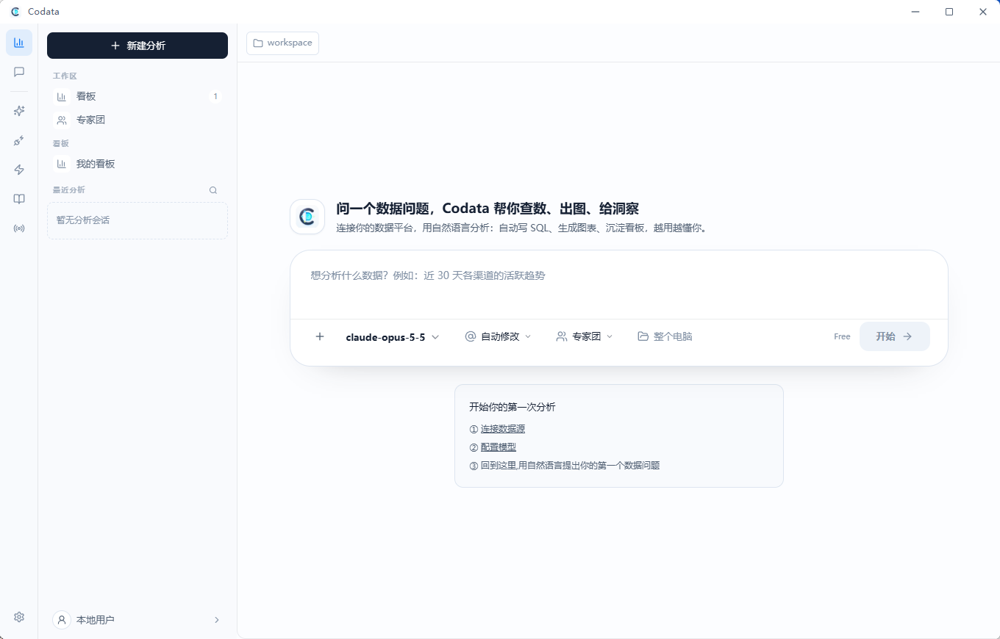
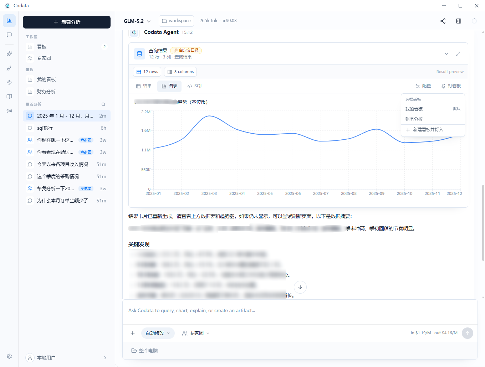
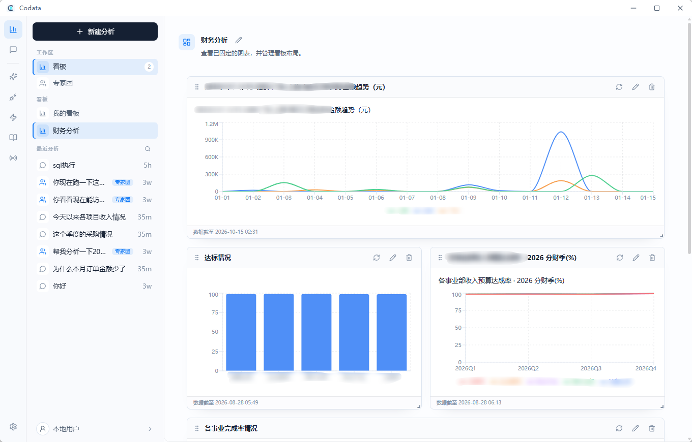
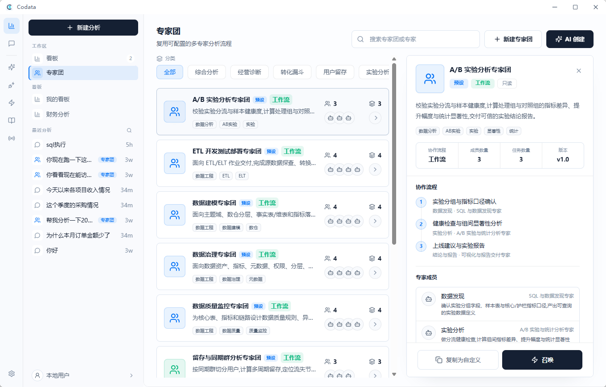
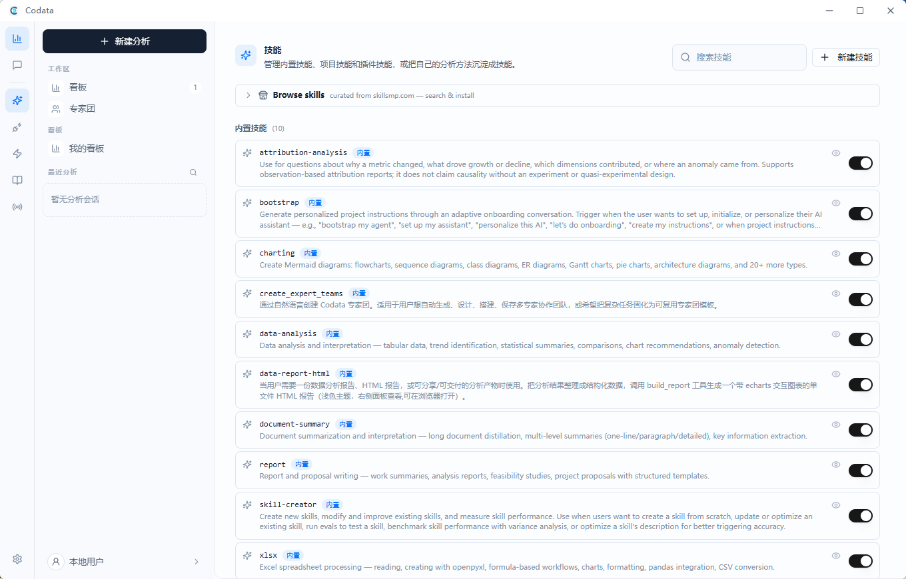
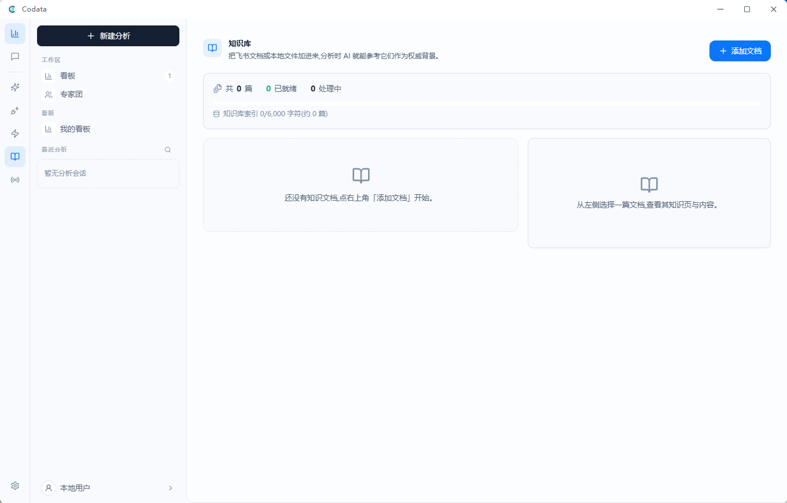
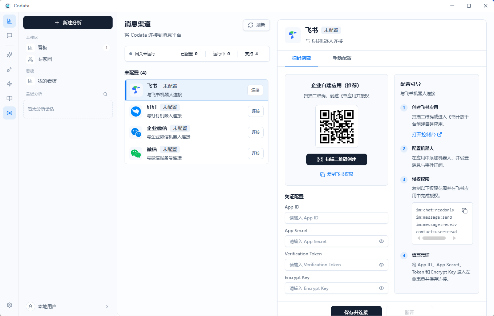

# Codata

<div align="center">
  

  <h3>本地优先的 Data Agent：自然语言查数、SQL、图表、看板和专家团分析工作流</h3>

  <p>
    <a href="https://github.com/Mlilion/Codata/releases/latest"><b>⬇ 下载 Codata（Windows / macOS）</b></a>
    &nbsp;&nbsp;|&nbsp;&nbsp;
    <a href="#社群与交流"><b>在线 Demo 体验 · 扫码进群</b></a>
    &nbsp;&nbsp;|&nbsp;&nbsp;
    <a href="https://github.com/Mlilion/CodataAdmin"><b>语义模型后台 CodataAdmin</b></a>
    &nbsp;&nbsp;|&nbsp;&nbsp;
    <a href="README.en.md">English</a>
  </p>

  <p><sub>用自然语言问数据，看 SQL、看结果、出图表，并把有价值的分析沉淀到看板。</sub></p>

  <p>
    
  </p>

  <p><b>在线 Demo 体验，微信扫码进群</b></p>
  <p>
    
  </p>
  <p><sub>二维码失效？前往<a href="#社群与交流">社群与交流</a>添加维护者微信进群。</sub></p>
</div>

Codata 是一个开源、本地优先的桌面 Data Agent 工作区。它把本地桌面应用、Next.js 前端和 FastAPI Agent 后端组合在一起，让分析师和业务团队可以用自然语言提出数据问题，由 Agent 发现表和指标口径、生成或复用 SQL、执行查询、展示结果卡片、生成图表，并把有价值的结果钉到看板。

Codata 的产品主线是一条清晰的数据分析链路：

```text
提出数据问题
  -> 发现表 / 字段 / 指标口径
  -> 生成或复用 SQL
  -> 在已连接的数据平台执行查询
  -> 查看结果、SQL 和图表
  -> 钉到看板，或交给专家团做深度分析
```

## 亮点

- **自然语言数据分析**：直接问“按渠道对比付费转化率”或“找出本周最大异常下滑”。
- **面向数据源的 Agent 流程**：Data Agent 会先检查 schema、搜索注册指标、避免臆造表字段、执行 SQL，并根据错误修复查询。
- **SQL 结果卡片**：查询结果以结构化 artifact 展示，保留表格、SQL、字段、行数据和图表元数据。
- **指标口径约束**：核心业务指标优先使用已注册指标定义；没有权威口径时，会显式标注为自定义口径。
- **看板沉淀**：把图表结果钉到命名看板，支持重命名、布局调整、删除和基于原 SQL 刷新。
- **专家团深度分析**：复杂问题可以交给多 Agent 专家团，拆分成数据发现、SQL、归因、可视化和报告交付等步骤。
- **本地优先桌面运行时**：对话、设置、看板、记忆、artifact 和工作流元数据默认存储在本机。
- **自带模型**：支持 OpenAI-compatible provider、自定义 endpoint、直接 provider adapter 或本地 Ollama。
- **可扩展工具体系**：按配置启用 MCP、技能、插件、文件工具、报告生成和桌面集成能力。

## 功能截图

### 产品主界面

本地优先的桌面工作区：左侧集中看板、专家团、技能、知识库和最近分析，中间直接提出数据问题。



### 自然语言问数：结果、图表与 SQL

一次提问即可得到查询结果卡片、图表和可展开的 SQL；结果带口径标记，可继续追问或钉到看板。



### 数据看板

把有价值的图表钉到命名看板，按布局排列，并随时沿原 SQL 刷新。



### 专家团分析

按分析场景复用多专家协作流程，查看成员、任务、依赖关系和协作顺序。



### 技能

内置技能覆盖归因分析、图表、数据报告、Excel 处理等场景，可逐项启用，也可以把团队的分析方法沉淀成新技能。



### 知识库

把文档和本地资料加入知识库，分析时作为权威背景引用。



### 消息渠道

将 Codata 连接到飞书、钉钉、企业微信和微信，在聊天中直接使用分析能力。



> 截图中的业务数据与名称已做模糊处理，实际界面以当前版本为准。

<details>
<summary><kbd>目录</kbd></summary>

- [Data Agent 工作流](#data-agent-工作流)
- [核心能力](#核心能力)
- [看板与产物](#看板与产物)
- [专家团](#专家团)
- [技术架构](#技术架构)
- [配套项目](#配套项目)
- [功能截图](#功能截图)
- [快速开始](#快速开始)
- [开发命令](#开发命令)
- [仓库结构](#仓库结构)
- [数据边界](#数据边界)
- [社群与交流](#社群与交流)
- [开发说明](#开发说明)

</details>

## Data Agent 工作流

Codata 不是通用聊天壳，而是围绕数据分析设计的桌面 Agent。在 Codata 模式下，助手应当：

1. 理解用户的分析目标。
2. 通过已连接的数据平台发现可用表、字段和指标定义。
3. 核心业务指标优先使用注册指标的计算口径。
4. 在 schema 和口径明确后再写 SQL。
5. 通过数据执行工具运行查询。
6. 根据数据平台返回的错误修复 SQL。
7. 用具体数字、口径说明、限制和 SQL 解释结论。
8. 在需要复用时生成图表、看板或报告。

请自行配置 MCP 数据源；项目不预置服务地址或组织专用连接器。Agent 会发现数据源实际提供的 schema 和查询工具；有注册指标时优先使用,但不要求必须存在语义模型。内置 `run_query` 和基于 SQL 的看板刷新需要兼容的 `execute_sql` 返回协议（参考 data-client 适配器）；其他数据源使用自身 MCP 查询工具，可能不支持自动刷新看板。未连接数据源时，Codata 会引导用户先连接数据源。

## 核心能力

### 自然语言查数

用户用业务语言描述问题，Codata 将其转成数据分析流程：schema 检查、指标检索、SQL 生成、执行查询和结论解释。

### SQL 与结果可检查

SQL 结果不会被藏在一段文字后面。Codata 会保留查询结果、SQL、字段、行数据和图表元数据，方便用户确认答案从哪里来。

### 指标口径意识

对于 DAU、GMV、转化率、留存、收入、成本等核心指标，Codata 会优先查找注册指标定义。没有注册指标时，回答中应说明这是自定义口径，避免把未经验证的 SQL 当成权威指标。

### 图表和看板

Codata 可以把查询结果渲染成图表卡片，并钉到看板。看板项会保存 SQL 结果快照，在数据源可用时可以沿原执行路径刷新。

### 分析记忆

Codata 会在本地保存结构化分析记忆，让常见主题、指标偏好和用户习惯能在后续数据会话中继续发挥作用。

### 文件和报告

桌面运行时可以读取 CSV、Excel、PDF、文档和工作区文件。数据分析结果可以根据工作流交付为 Markdown、HTML、办公文档、代码 artifact 或看板面板。

## 看板与产物

Codata 将日常探索和可复用产物分开：

- **内联结果卡片**：适合一次性探索和追问。
- **看板图表**：适合长期监控、复盘和对比。
- **生成报告**：适合把一次分析保存为可分享的静态快照。
- **Artifact 面板**：让生成文件、HTML、代码和预览与对话并排展示。

## 专家团

专家团是 Codata 处理复杂分析的编排层。一个专家团是一份结构化配置，包含成员、任务、依赖、上下文策略、工具和最终交付规则。

在数据场景中，专家团可以把一个复杂问题拆给不同角色：

- 数据发现与 schema 检查
- 指标口径确认
- SQL 执行与纠错
- 归因分析或异常定位
- 图表规格设计
- 报告撰写与最终交付

Codata 支持三种执行模式：

| 模式 | 适合场景 | 工作方式 |
| --- | --- | --- |
| `sequential` | 线性分析流程 | 按任务顺序执行。 |
| `workflow` | 固定依赖图 | 构建 DAG，运行依赖已满足的任务。 |
| `hierarchical` | 开放式复杂调查 | Manager Agent 委派专家并综合最终答案。 |

## 技术架构

```text
User
  -> Tauri desktop shell
  -> Next.js frontend
  -> FastAPI backend
  -> agent runtime, data tools, dashboards, expert teams, storage, providers, MCP
```

- **Tauri 桌面外壳**：原生打包、桌面权限、updater 集成、资源打包和平台相关行为。
- **Next.js 前端**：Codata 工作区、聊天、数据结果卡、看板、专家团、artifact、设置、插件和活动面板。
- **FastAPI 后端**：Agent loop、可恢复流式输出、MCP 工具集成、SQL 执行封装、看板刷新、专家团编排、文件解析、SQLite 持久化、provider 路由和定时任务。

## 配套项目

- **[CodataAdmin 语义模型后台](https://github.com/Mlilion/CodataAdmin)**：配套的语义治理与管理平台，用于维护业务域、业务实体、语义字段、语义模型、JOIN、指标、维度和知识库，并通过 MCP Server 提供可信取数能力。Codata 连接其 MCP Server 后，可直接使用已发布的语义模型和指标口径进行分析。

## 下载与文档

- 桌面端下载（Windows / macOS）：https://github.com/Mlilion/Codata/releases/latest
- 最新版本清单（JSON，含各平台安装包直链、大小和 SHA-256）：https://github.com/Mlilion/Codata/releases/latest/download/downloads-latest.json
- 源码与版本发布：https://github.com/Mlilion/Codata

下载页中包含以下安装包：

| 平台 | 安装包 |
| --- | --- |
| Windows x64 | `Codata_<版本>_x64-setup.exe`（NSIS 安装程序） |
| macOS Apple Silicon | `Codata_<版本>_arm64.dmg` |
| macOS Intel | `Codata_<版本>_x64.dmg` |

> 开源版默认关闭自动更新，请从 GitHub Releases 手动安装新版本。发布构建覆盖 Windows x64、macOS Apple Silicon 和 Intel；Linux 尚未完成发布验收。macOS 发布流程要求 Developer ID 正式签名、Apple 公证及票据装订，缺少凭据或验证失败会阻止发布；Windows 安装包尚未配置发行者签名，可能触发 SmartScreen 提示。维护者配置见[发布签名说明](CONTRIBUTING.md#macos-release-signing-and-notarization)。

## 快速开始

### 环境要求

- Node.js 20 或更新版本。
- Python 3.12 或更新版本。
- Rust 和 Cargo，用于 Tauri 桌面构建。
- macOS、Windows 或 Linux 对应的 Tauri 平台依赖。
- 可用的模型 provider、OpenAI-compatible endpoint、自定义 endpoint 或本地 Ollama 模型。
- 用户自行配置的 MCP 数据源，用于真实数据库分析。

### 安装依赖

Windows PowerShell（需已安装 Python 3.12、Node.js 和 npm）：

```powershell
git clone https://github.com/Mlilion/Codata.git
Set-Location Codata
npm ci
npm --prefix frontend ci --legacy-peer-deps
npm --prefix desktop-tauri ci
py -3.12 -m venv backend\venv
.\backend\venv\Scripts\python.exe -m pip install -e "./backend[dev,build]"
```

macOS / Linux：

```bash
git clone https://github.com/Mlilion/Codata.git
cd Codata
npm ci
npm --prefix frontend ci --legacy-peer-deps
npm --prefix desktop-tauri ci
python3.12 -m venv backend/venv
./backend/venv/bin/python -m pip install -e "./backend[dev,build]"
```

开发依赖使用版本范围，发布打包使用 `backend/requirements.txt`。发布构建应在构建环境中安装该文件并保留实际解析的依赖清单，不应认为开发环境自动等同于发布环境。

### 启动开发栈

```bash
npm run dev:all
```

前端开发服务器使用 `3000` 端口，后端开发服务器使用 `8000` 端口。桌面开发会启动 Tauri 外壳并连接本地前端和后端栈。

浏览器开发请使用 `dev:all`，单独启动前端不会生成前后端共享的开发会话令牌。不配置模型凭证也能查看界面，但模型调用需要用户自己的 Key 或本地模型；真实查数需要用户自己的 MCP 连接，项目不附带演示数据库。

## 开发命令

```bash
npm run dev:frontend
npm run dev:backend
npm run dev:desktop

npm run build:frontend
npm run build:backend
npm run sync:desktop-meta
npm run build:desktop
```

首次桌面开发或构建前，运行 `npm run prepare:desktop-runtime` 下载固定版本的 Node.js 运行时及其许可证。桌面构建还需要平台对应的 Tauri 系统依赖、Rust 工具链和上述 build extra（PyInstaller）。`build:desktop` 会通过 Tauri 构建钩子生成前后端资源；本地未签名构建不需要发布令牌或签名密钥。

验证命令：

```bash
npm run verify:open-source-boundary
npm run audit:open-source-boundary:strict
npm run verify:frontend-assets
npm run preflight:ui
```

桌面发布构建依赖 `frontend/out` 中导出的前端静态资源，以及 `backend/dist/codata-backend` 中的后端 bundle。桌面构建前运行 `npm run sync:desktop-meta`，确保 Tauri metadata 与根 package 版本一致。

## 仓库结构

```text
desktop-tauri/    Tauri v2 桌面外壳与 Rust 集成
frontend/         Next.js UI，包含 Codata 工作区、聊天、看板、专家团、设置和 artifact
backend/          FastAPI 后端、Agent runtime、数据工具、专家编排、存储和 provider 层
scripts/          构建、发布、验证、签名和版本工具
design-system/    产品设计参考和视觉资产
```

## 数据边界

模型供应商和 MCP 连接均由用户配置，不内置模型/API 默认代理；如有需要，可通过 `CODATA_PROXY_URL` 设置自己的 HTTP 代理。项目不再内置企业 SSO 连接器和 SAP 浏览器集成。本次源码清理不会擦除源码目录外的用户设置，复用旧安装前请检查已保存的连接器。

发布前运行 `npm run audit:open-source-boundary:strict`。检查覆盖当前源码快照（包括未跟踪文件），无需 Git 元数据；不覆盖 Git 历史，也不代替公司代码发布授权、凭据和许可证审查。

Codata 默认在本地存储对话、看板状态、生成产物、设置、记忆和工作流元数据。当用户选择云端模型或外部连接器时，相关 prompt 上下文和必要 payload 会发送给对应 provider 或 connector。

数据库分析依赖用户已连接的数据平台及其权限。用户需要自行选择符合安全、隐私和合规要求的 provider 路径、模型访问方式、数据源权限、SQL 安全规则、连接器范围和部署设置。

本地优先不等于完全离线：云模型、MCP 工具、消息渠道、目录与运行时下载，以及部分依赖 CDN 的预览会访问网络。数据边界见 [安全策略](SECURITY.md)，分发义务见 [第三方声明](THIRD_PARTY_NOTICES.md)。PPTX 文件可下载，但不提供可视化预览。

## 社群与交流

在线 Demo 体验请扫码加入 Codata 用户交流群，获取体验方式，也欢迎反馈使用问题、交流数据分析场景和建议新功能。

<table>
  <tr>
    <td align="center" width="50%">
      
      <br />
      <sub><b>Codata Agent 交流群</b><br />微信扫码直接进群</sub>
    </td>
    <td align="center" width="50%">
      
      <br />
      <sub><b>维护者微信</b><br />扫码添加，备注「Codata」</sub>
    </td>
  </tr>
</table>

群二维码有时效限制（通常 7 天），过期后请扫描右侧维护者微信二维码，备注「Codata」，维护者会拉你进群。也可以通过 [GitHub Issues](https://github.com/Mlilion/Codata/issues) 反馈问题。

## 开发说明

Issue、评审和贡献流程见 [贡献指南](CONTRIBUTING.md)。合并前请根据修改范围运行对应验证命令，并重点关注数据源权限、模型 provider 路由、SQL 安全规则，以及哪些上下文可能离开本机。安全处理要求见 [安全策略](SECURITY.md)。
